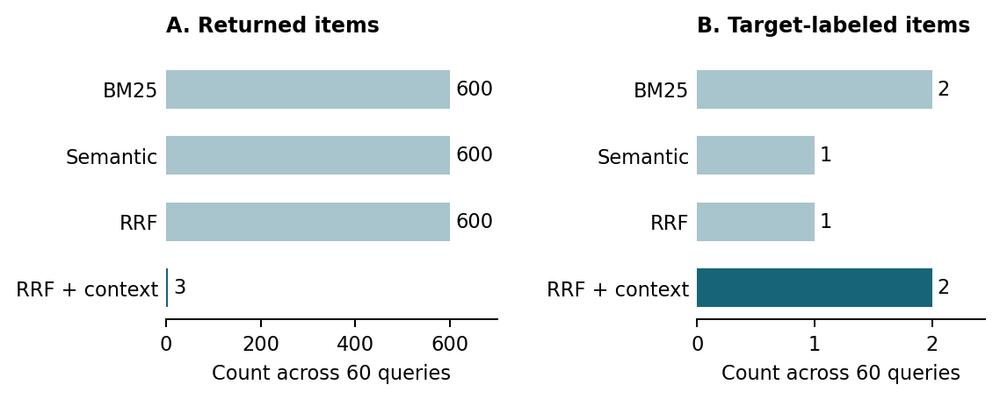

# PatchCheck

Find player reviews about the specific problems described in game-fix announcements.

PatchCheck compares keyword retrieval (BM25), semantic retrieval, reciprocal-rank fusion (RRF), and RRF with a context filter. It helps inspect whether reviews describe the same issue and whether that issue is still occurring.

[Pipeline](docs/PIPELINE.md) · [Results](evaluations/2026-11-03/README.md) · [Run the analysis](evaluations/2026-11-03/REPRODUCTION.md)

## Current results

The November 3, 2026 experiment covers 60 games, 39,944 eligible statement-review pairs, and 1,215 distinct pairs in the returned results.



The context method returned 3 items and no items for 57 of 60 games. Its target yield exceeded RRF by 0.167 percentage points (paired sign-flip p = 1.0). These sparse results do not establish a performance advantage. The [reference labels](evaluations/2026-11-03/REFERENCE-PROVENANCE.md) support exploratory comparison, not independent validation or claims that a patch fixed an issue.

Next steps are to inspect uncertain and empty-result cases, freeze one justified method change, and evaluate it on separate games with fresh judgments.

## Run locally

Python 3.12 or newer; standard library only. From the repository root:

```sh
python3 evaluations/2026-11-03/reproduce_analysis.py --output replay.json
```

The command verifies 23 source files and reproduces the saved numerical comparison without network access. Choose a new output filename for each run.

## Repository

| Path | Contents |
|---|---|
| [docs/PIPELINE.md](docs/PIPELINE.md) | Method and source-code guide |
| [evaluations/2026-11-03/](evaluations/2026-11-03/) | Analysis code, deidentified reference codes and saved results |
| [evaluations/2026-11-02/evidence/](evaluations/2026-11-02/evidence/) | Frozen protocol, context prompt and run summaries |
| [DATA-SOURCES.md](DATA-SOURCES.md) | Dataset attribution and reuse boundaries |
| [AI-USE.md](AI-USE.md) | AI disclosure |

This repository contains code and a saved-data analysis subset. Full review archives, model environments, reports and presentation files are not included.
